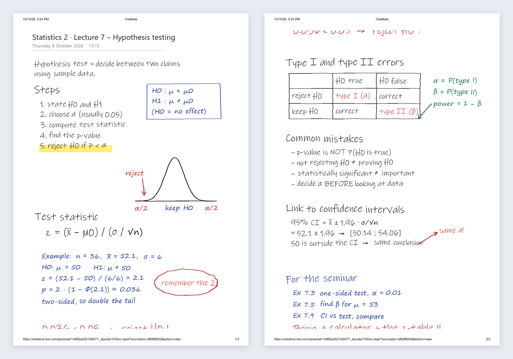
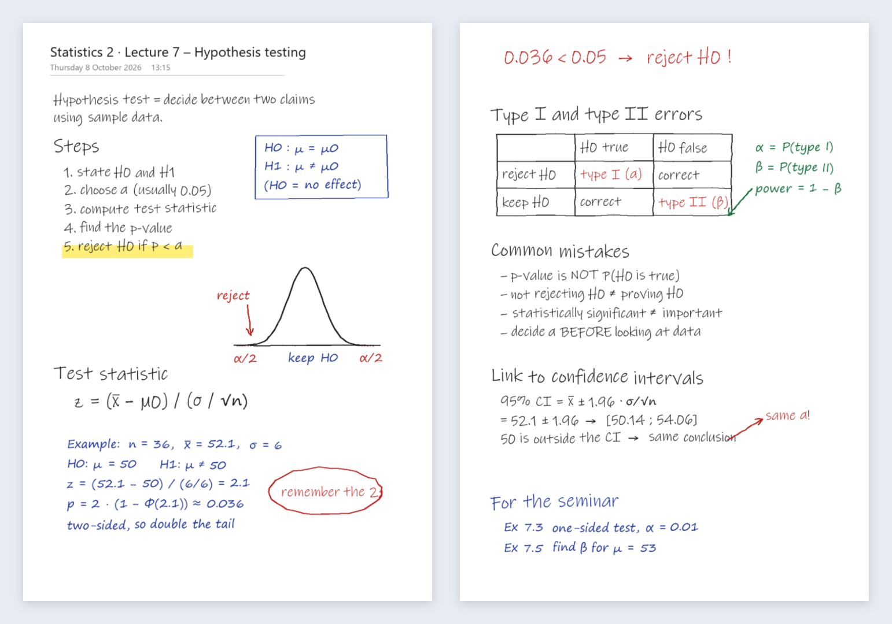

# Pagefit

**Handwritten OneNote notes, printed the way you wrote them.**

You write your notes by hand in OneNote, but when you print them or save them as a PDF, they come out wrong. Lines of handwriting are sliced in half between two pages, the right side of your writing is cut off, and dates, web addresses and page numbers are printed over your notes. OneNote has no setting that fixes it, so you end up printing screenshots or rewriting notes by hand. **If that sounds familiar, Pagefit is for you.** It turns your OneNote file into clean A4 pages that look the way you wrote them.

**Try it:** https://a20sarle.github.io/one-note-free-form-print-split/

## Before and after

**Before:** the PDF OneNote gives you. The red conclusion "0.036 < 0.05 → reject H0 !" is sliced in half between pages 1 and 2, and every page has a date, "OneNote" and a web address printed on it.

**After:** the same file through Pagefit. The line is whole again at the top of the next sheet, every page break falls between lines, and the printed clutter is gone.

You prepare a lecture on your iPad, write it out by hand in OneNote, and then print it for class or share it as a PDF. That's when things go wrong:

- **Lines are sliced in half.** OneNote cuts the page at fixed heights, straight through your handwriting.
- **The right side goes missing.** The writing area is wider than an A4 sheet, so anything past the edge is cut off.
- **Clutter is added.** Dates, times, "OneNote", web addresses and page numbers are printed over and around your notes.
- **There's no setting that fixes it.** OneNote on the iPad has no page-size or page-break controls, so you end up fixing things by hand or printing again.

Pagefit fixes this in a few seconds.

## Who it's for

University teachers and lecturers who write by hand in OneNote, usually on an iPad with an Apple Pencil. It's for anyone who needs those notes on paper or in a PDF for students: lecture notes, worked examples, exercise solutions or board drawings. It works just as well for students and anyone else who takes handwritten notes in OneNote.

## What it does

- **Rejoins split lines.** Pagefit puts the pages back together, so a line that OneNote cut in half becomes one line again.
- **Moves page breaks into gaps.** Every break goes into the empty space between lines, never through your writing.
- **Keeps the full width.** Take screenshots instead of exporting, and Pagefit finds your note, removes OneNote's toolbar and page list, and joins the screenshots into one page.
- **Removes the clutter.** Printed headers and footers and the page title are removed. Your handwriting, including anything under them, stays.
- **Lets you place space.** Click anywhere on a sheet to add 2 or 4 cm of space there, so a section or drawing starts on the next sheet.
- **Shows the result first.** A large, page-by-page preview, like reading the final PDF, shows exactly what will be printed.
- **Gives you a clean PDF.** Download A4 or Letter, portrait or landscape, ready to print or share.

## How to use it

1. Open Pagefit in Safari, Chrome or Edge, on the iPad or a computer.
2. Choose **PDF** and pick the file you exported or printed from OneNote. If your page is wider than the export, choose **Screenshots** instead.
3. Check the sheets. Click a sheet to add space if you want to.
4. Click **Download PDF**.

The page includes a short guide for getting your notes out of OneNote on the iPad, the Mac and the web.

## Private by design

Everything happens in your browser. Your notes are never uploaded, stored or sent anywhere, so it's safe for exams, solutions and student material.
